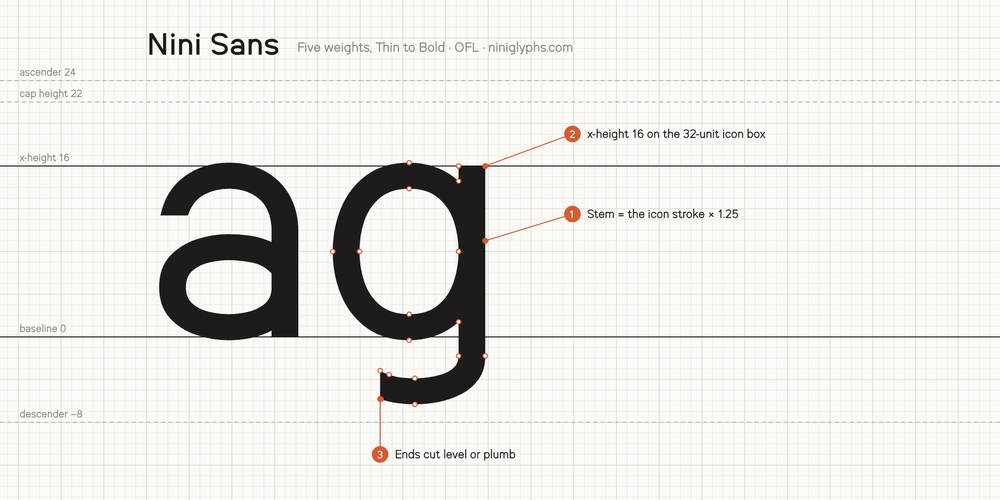

# Nini Sans



Nini Sans is a grotesk drawn with the pen of Ninicons, an open-source icon set, so that its text and its icons read as one system. Five weights (Thin, Light, Regular, SemiBold, Bold), each matched to a Ninicons icon stroke.
Its sibling is [Nini Mono](https://github.com/niniglyphs/nini-mono).

The em is the 32-unit icon box. Capitals stand on the square keyline (22 units), ascenders reach the circle keyline (24) and the x-height is 16, Helvetica's proportion to the capitals; at 16 px every one of these falls on a whole pixel. Bowls are slightly squared ovals, terminals are cut level or plumb as Helvetica's and Geist's are, the a is double-storey and the g single-storey, and the t's foot is the j's hook turned round.

## Character set and features

- Google Fonts Latin Core: Latin-1, Latin Extended-A, Romanian (Ș ș Ț ț), Welsh (Ẁ Ẃ Ẅ Ỳ), the capital sharp s (ẞ), and
  common punctuation, currency, maths and arrow symbols.
- Combining marks (U+0300–U+0304, U+0306–U+0308, U+030A–U+030C, U+0326–U+0328, U+0331) with `mark`/`mkmk` positioning; capitals take flatter capital marks
  and i, j and į lose their dots under a mark above (`ccmp`).
- Kerning (`kern`); proportional figures by default, tabular figures and currency signs (`tnum`).
- Statically hinted TrueType (ttfautohint), plus WOFF2 for the web.

## Building

The fonts build from the UFO sources in `sources/` with [gftools builder](https://github.com/googlefonts/gftools)
(fontmake), in one step:

```bash
python -m venv venv
. venv/bin/activate          # Windows: venv\Scripts\activate
pip install -r requirements.txt
cd sources && gftools builder config.yaml
```

This writes `fonts/ttf/` and `fonts/webfonts/`. Check them as Google Fonts does, with
[fontspector](https://github.com/fonttools/fontspector):

```bash
fontspector --profile googlefonts -x googlefonts/repo/dirname_matches_nameid_1 fonts/ttf/*.ttf
```

## About the sources

The sources are UFO 3 files, one per weight, and open in any font editor.

## License

Copyright 2026 The Nini Sans Project Authors — Sayantan Roy (https://github.com/niniglyphs/nini-sans).

This Font Software is licensed under the SIL Open Font License, Version 1.1 ([OFL.txt](OFL.txt)), also available with a
FAQ at https://openfontlicense.org.

## Repository layout

```
├── OFL.txt, AUTHORS.txt, CONTRIBUTORS.txt, README.md, requirements.txt
├── documentation/          specimen images; article/ is the Google Fonts "About" page
├── sources/                NiniSans-*.ufo and config.yaml (gftools builder)
└── fonts/ttf, fonts/webfonts
```

Source: https://github.com/niniglyphs/nini-sans
